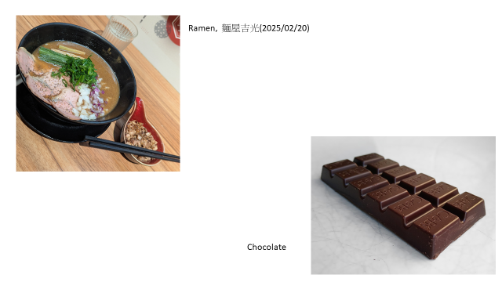
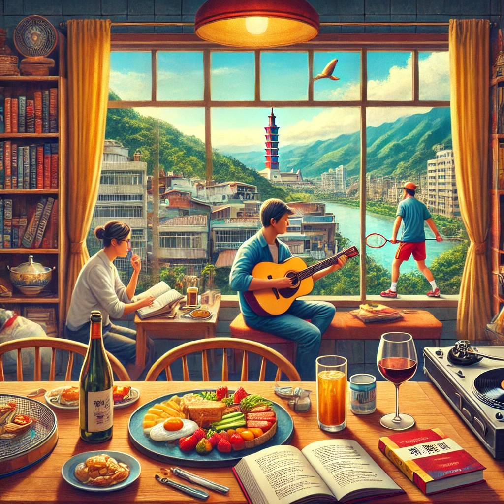

# Map · Food · Smile

A more personal side of this website, beyond mathematics and research.

## Map

I was born and raised in Muzha, Taipei. I studied Applied Mathematics at NCTU and later continued my graduate studies at NYCU.


## Food



## Smile

喜歡吃，喜歡音樂，喜歡閱讀，喜歡羽球，喜歡詩，喜歡酒，喜歡玩，喜歡臺灣，關心社會議題。

*I enjoy food, music, reading, badminton, poetry, wine, exploring new experiences, and thinking about Taiwan and society.*

以下插圖由 ChatGPT 根據我的自我介紹生成。



<details>
<summary>Image-generation prompt</summary>

```text
A vibrant indoor scene in a cozy Taiwanese setting, featuring a person reading poetry near a window with a view of Taiwan's iconic landscape. Another person is playing badminton in the background. The room is filled with musical elements like a classical guitar and a vinyl record player. On a nearby table, there are various gourmet dishes, a glass of wine, and books scattered around, creating a culturally rich atmosphere.
```

</details>
